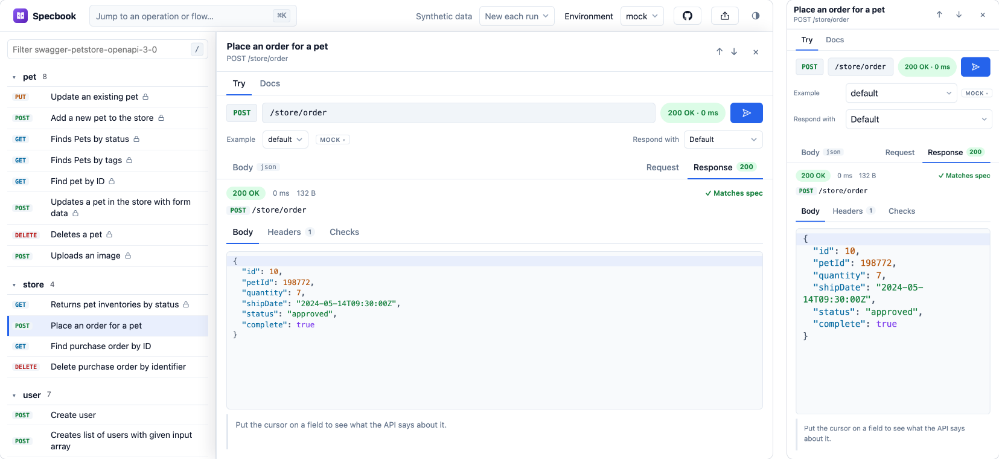

<p align="center">
  
</p>

<h1 align="center">Specbook</h1>

<p align="center"><strong>Storybook for APIs</strong></p>

<p align="center"><em>Same spec. Way more swagger.</em></p>

<p align="center">
  <picture>
    <source media="(prefers-color-scheme: dark)" srcset=".github/screenshot-pair-dark.png" />
    
  </picture>
  <br />
  <sub>Petstore, opened from a link, on a laptop and on a phone. The response is a mock that matches the spec. Set Environment to live and the same request goes to the real API.</sub>
</p>

A drop-in alternative to Swagger UI. Open an OpenAPI or Swagger document and get a browsable, runnable API
explorer: mock responses from the first request, live calls from the browser, flows that chain requests, and
links you can share. Serve it from your API's own docs route and it runs on your origin, so there is no CORS
to configure.

**Try it:** [ui.specbook.dev](https://ui.specbook.dev). Paste the address of a spec, or drop the file. It is
read in your browser; nothing is uploaded.

- **Mock from the first request.** Responses are generated from the spec and follow what you send: posted
  fields come back, query filters shape lists, path parameters become ids.
- **Live calls.** The same requests run against the real API from your browser. Served from the API's own
  origin there is no CORS; from elsewhere it works for APIs that allow browser calls. Credentials stay in the tab.
- **Sign in.** OAuth 2.0 and OpenID Connect APIs get a Sign in button (PKCE, no client secret); the token stays
  in the tab. [How to set it up](#sign-in-to-oauth-apis).
- **Test and monitor.** The same requests and flows run in CI and against production, with no spec needed, and QA
  can run them from a published portal. [How](docs/testing-and-monitoring.md).
- **Flows.** Chain requests, capture values from one response into the next, and assert on the way.
- **Share a view.** A link opens the same operation for someone else, for any spec served from a public address.
- **Embed it.** Serve the viewer from your API's docs route: it runs on your origin, so no CORS, and your
  visitors' cookies are sent.

## Embed the viewer

```html
<div id="app"></div>
<script type="application/json" id="specbook-config">{"spec": "/v3/api-docs"}</script>
<script type="module" src="https://ui.specbook.dev/v1/specbook.js"></script>
```

The script runs on your page's origin, so the spec and the API calls need no CORS and carry the visitor's
cookies. `spec` may be relative; `baseUrl` supplies the API address when the document has none.

## CORS: which option?

| Situation | What to do |
| --- | --- |
| It is your API | Embed the viewer in your docs route (above). It runs on your origin: no CORS, cookies sent. |
| Your policy will not load a third-party script | Self-host the viewer (below). |
| You want the hosted viewer inside your page | An iframe of ui.specbook.dev works, but it is cross-origin, so the API still has to allow it. An iframe of your self-hosted copy is same-origin. |
| It is someone else's API | It works when that API allows browser calls. A browser extension for the rest is planned. |

## Self-host the viewer

The built viewer is a folder of static files. It uses relative paths, so it runs from any directory your server
already serves, and the embed script (`specbook.js`) is in the same folder, so nothing is loaded from
`ui.specbook.dev`.

**From a release.** Each release attaches `specbook-viewer-<version>.zip`, `SHA256SUMS` and a build
attestation. Check it and unpack it:

```sh
sha256sum -c SHA256SUMS
unzip specbook-viewer-0.1.0.zip -d public/specbook
```

**From npm.** The same folder ships in the `@specbook/ui` package as `dist-viewer/`:

```sh
npm install --save-dev @specbook/ui
cp -r node_modules/@specbook/ui/dist-viewer public/specbook
```

Open it with the address of your spec: `https://your-host/specbook/?spec=https://your-host/openapi.json`. To
embed it in a page of your own instead:

```html
<div id="app"></div>
<script type="application/json" id="specbook-config">{"spec": "/openapi.json"}</script>
<script type="module" src="/specbook/specbook.js"></script>
```

On the same origin, a strict Content-Security-Policy needs `script-src 'self'` and `worker-src 'self'`. Loading
the hosted script instead needs the viewer's host in `script-src` and `worker-src blob:`.

In a Spring Boot app, put the unpacked files under `src/main/resources/META-INF/resources/specbook/` and they
are served at `/specbook/`.

The folder includes `THIRD-PARTY-NOTICES.txt`, with the licence text of every library built into the viewer.
Keep it with the files you host.

## Add a button to your README

```md
[](https://ui.specbook.dev/v1/?spec=<address of your OpenAPI file>)
```

Anyone who clicks it gets your API open and runnable, with nothing to install. The landing page at
[ui.specbook.dev](https://ui.specbook.dev) has a generator that writes this line for you.

## Theme it

Every colour, font and radius is a CSS variable, so a page that embeds the viewer restyles it from its own
stylesheet. Light and dark follow the visitor's system; `data-theme="light"` or `"dark"` on the root forces one.

```css
:root {
  --sb-accent: #e11d48;
  --sb-accent-hover: #be123c;
  --sb-font-sans: "Inter", system-ui, sans-serif;
  --sb-radius-card: 14px;
}
```

The variables are in [`tokens.css`](packages/ui/src/styles/tokens.css): surfaces (`--sb-bg`, `--sb-surface`,
`--sb-border`), text, accent, status colours, one colour per HTTP method, code colours, fonts, radii and spacing.

## Use it in a project

The command line turns a project's specs into types, examples, a docs site and runnable requests. Needs Node 24.

```sh
npm install --save-dev @specbook/cli @specbook/core
```

Run the install above first; after that, `npx specbook` runs the installed copy. To look at a document with
no project, `npx @specbook/cli preview <url|file>` works without installing anything.

```sh
npx specbook init                # scaffold config, the #api/* import and an environments folder
npx specbook add petstore --spec ./openapi/petstore.json   # or a URL: it is downloaded and recorded
npx specbook generate            # types and mock examples from the specs; dev, build and test do it when needed
npx specbook dev                 # the UI: docs, a play panel and a credential proxy
npx specbook build               # a static docs site, and specbook.js to embed it
npx specbook test --env mock     # run requests and flows
npx specbook build --minimal     # a portal with just your requests and flows, for QA
npx specbook bundle              # the tests as one .mjs that runs with just node, for ops and CI
npx specbook check               # validate specs, generated code drift, environment files and addresses
npx specbook preview <url|file>  # open any document in the UI, with no project
```

`npx specbook build --viewer` also copies the spec viewer next to the site, for a team that serves it from its
own host (open it with `?spec=<url>`).

### Test, and monitor

A developer writes a request or a flow once. QA runs it with a click in a published portal (`specbook build --minimal`),
CI runs it with `specbook test --env staging`, and ops run it against production on a schedule: `specbook bundle`
compiles the tests into one file, and `node specbook-tests.mjs --env prod --safe --tag monitor` runs it with nothing
installed.

Pass `--safe` against production and a run only reads. A failure shows what was expected and what came
back, with credentials removed. The exit code is 0 (passed), 1 (a test failed), 2 (could not run) or 3 (usage).
See [Testing and monitoring](docs/testing-and-monitoring.md).

### Mocks

The `mock` environment needs no server. It answers from the examples `generate` writes from your spec (the response's
`example` if the spec has one, else a value built from its schema), filled in from the request: a field you posted, the
id in the path or a query value comes back in the response, so `GET /pet/7` answers with pet 7.

That is usually enough. When a check needs data the example does not have, wrap the request in `withMock`; it is the
file's one export, and `req` and `res` are typed from the operation:

```ts
export default withMock(
  GetOrderById.request({ /* ... */ }),
  (req, res) => {
    if (res.status === 200) res.data.status = 'placed'            // change what the example says
    if (req.vars.paymentMethod === 'pm_card_chargeDeclined')
      res.respond(402, { error: { code: 'card_declined' } })      // or answer another declared status
    res.headers['x-rate-limit'] = '9'                              // headers and a delay (res.delayMs) too
  },
)
```

In the UI, **Respond with** picks a status for any request in the `mock` environment.

### Config, variables and secrets

A document opened in the viewer or with `specbook preview` gets an environment for each entry in its `servers`
(`live` first, the rest named from their description). Credentials are kept per API origin, so a key typed for
one server is never sent to another.

In a project, `vars` in the config are the defaults for every environment. `.specbook/environments/<env>.env`
(or `environments.<env>.vars`) overrides them for one environment, and `<env>.secrets.env`, which the folder's
`.gitignore` keeps out of the repository, holds its secrets. A service's address is a variable, so each
environment can point elsewhere:

```ts
vars: { petstoreUrl: 'https://petstore3.swagger.io/api/v3' },
services: { petstore: { spec: './openapi/petstore.json', baseUrl: '{{petstoreUrl}}' } },
```

```sh
# .specbook/environments/staging.env
petstoreUrl=https://staging.petstore.example/api/v3
```

`specbook add` writes this from a spec's `servers`. In the UI, **Environment settings** shows an environment's
variables and where its calls go, and **New environment…** copies one (kept in the browser when there are no
project files). `npx specbook secrets --env <name>` shows where each secret comes from, never the values.

### Sign in to OAuth APIs

A scheme with an OAuth 2.0 authorization code flow, or an OpenID Connect one, gets a **Sign in** button beside
the credentials prompt. It uses PKCE, so there is no client secret, and the token stays in the tab. Register a
public client with the provider and allow this redirect URI:

| Where you run it | Register this redirect URI |
| --- | --- |
| The hosted viewer | `https://ui.specbook.dev/oauth/callback/` (it does not change when the viewer's version does) |
| A viewer you embed or host yourself | That page's own address |
| `specbook dev` and `specbook preview` | The address they print |

From the hosted viewer or a static build the browser makes the token exchange, so the provider must also allow
the page's origin (CORS; for the hosted viewer `https://ui.specbook.dev`). Through `dev` and `preview` the dev
server's proxy makes it, so that is not needed. Sign-in needs a secure page (https, or localhost). If the
provider will not allow it, paste a token as before.

An auth profile's `oauth` addresses (`authorizationUrl`, `tokenUrl`, `openIdConnectUrl`, `clientId`) can be
variables like a service's address, so an environment can sign in at its own provider.

### Documentation beside the code

Markdown lives next to what it describes:

| File | Documents |
| --- | --- |
| `sequences/<name>.seq.md` | the flow in `<name>.seq.ts` |
| `requests/<name>.req.md` | the saved request in `<name>.req.ts` |
| `requests/<service>/<Operation>/README.md` | an operation, above its parameter tables |
| `requests/<service>/docs/<Operation>.md` | the same, flat: one `docs/` folder per service |

A heading made of one code span (`` ## `name` ``) attaches the text under it to that field.

## Develop

Needs Node 24 (`nvm use`) and pnpm.

```sh
pnpm install
pnpm build
pnpm lint
pnpm typecheck
pnpm test            # unit tests
pnpm test:browser    # the UI in a real browser
pnpm test:viewer     # the built viewer and landing page
pnpm test:slow       # a full site build, checking what the bundle contains
pnpm test:oauth      # sign-in against a real Keycloak (Docker); not part of CI, see below
```

`pnpm test:oauth` needs a Keycloak to talk to: `packages/ui/test/oauth/keycloak.sh up` starts one in Docker
(`down` removes it). The suite creates its own realm, client and user each run. In GitHub it is the
"OAuth (real provider)" workflow: weekly, and by hand from the Actions tab.

Try the example project (Petstore, Stripe, GitHub and a GraphQL API):

```sh
cd apps/example
pnpm exec specbook generate
pnpm exec specbook dev
```

### Layout

| Path | What |
| --- | --- |
| `packages/core` | the runner, mock engine, template engine and the shared proxy |
| `packages/codegen` | OpenAPI to types, examples, schemas and metadata (also runs in a browser) |
| `packages/cli` | the `specbook` command |
| `packages/vite` | the Vite plugin and the dev server's proxy |
| `packages/ui` | the app, the viewer, the landing page and the site assembly |
| `apps/example` | a project to try it on, and the fixtures for the tests |

## Contributing

Specbook's source is public, but it is not run as a pull-request project. The way to contribute is an
[issue](https://github.com/specbook-dev/specbook/issues): a bug with a spec that reproduces it, or a
document that does not load, or something you wanted to do and could not. Fixes are made in this repository
from those reports, with a test for each.

## License

The licence is set per package:

| Package | Licence |
| --- | --- |
| `@specbook/core`, `@specbook/codegen`, `@specbook/ui` (the viewer, the embed and the libraries behind them) | [MIT](LICENSE) |
| `@specbook/cli`, `@specbook/vite` (the project workflow tooling) | [FSL-1.1-MIT](packages/cli/LICENSE): free to use, including at work and in commercial projects. Each version becomes MIT two years after its release |

Companies can use the CLI and the Vite plugin: in their projects, in CI, to build and publish their own
documentation, and in commercial work. The one thing the Functional Source License does not allow is offering
Specbook, or something substantially similar built from it, to others as a competing commercial product or
service. Read [the licence](packages/cli/LICENSE) for the exact terms.

The Specbook name and logo are not licensed for use in forks.

The libraries built into the viewer are listed, with their licences, in `THIRD-PARTY-NOTICES.txt` in
the built viewer (it is generated by the build, which fails on a licence nobody has reviewed).

Specbook is an independent project and is not affiliated with Storybook (storybook.js.org) or Swagger.
